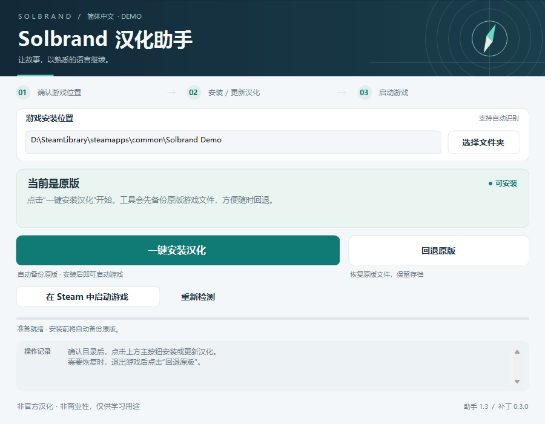

# Solbrand Demo 简体中文汉化与汉化助手

为 [Solbrand Demo](https://store.steampowered.com/app/4826310/Solbrand_Demo/) 制作的非官方简体中文补丁，以及支持一键安装、更新和回退的 Windows 助手。

**非商业性，仅供学习用途。** 本项目与游戏开发者、发行商无隶属关系。《日灼》仅为建议译名，并非官方中文名称。

| 项目 | 当前版本 |
| --- | --- |
| 中文补丁 | 0.4.1 |
| Windows 汉化助手 | 1.4.1 |
| 支持的 Steam Demo Build | 26869508、26815196 |



## 下载安装

前往本仓库的 **Releases** 页面，下载 `Solbrand-ZH-Assistant-v1.4.1.exe`，或下载同版本的 Windows ZIP 包。普通玩家无需编译源码。

1. 在 Steam 安装匹配版本的 Solbrand Demo，退出游戏。
2. 双击汉化助手，确认自动识别的游戏位置；也可点击“选择文件夹”。
3. 点击“一键安装汉化”或“更新至 0.4.1”，等待完成。
4. 点击“在 Steam 中启动游戏”。恢复时，退出游戏后点击“回退原版”。

助手会在游戏目录的 `.solbrand-zh` 中保存原版备份；在回退之前，请保留该目录。游戏运行时，安装、更新和回退操作会暂时禁用。游戏更新后若校验不匹配，工具会拒绝修改文件。

原版存档保留；汉化版使用独立的 `Solbrand Demo ZH` 用户目录。更新和回退不会迁移或删除这两套存档。

**Steam 更新后旧汉化失效：** 等待 Steam 更新完成，退出游戏，直接运行新助手。看到“Steam 已更新 · 需要重新汉化”时点击更新即可，不要先用旧助手回退，也不要删除备份目录。新助手会将旧版备份与记录完整保留在 `.solbrand-zh/archive/`，再备份新版原版；之后回退恢复新版，不会降级游戏。

## 汉化内容与当前限制

- 教程、主要与支线对话、图书馆、神话资料及作者解说的中文初稿。
- 界面、手册、百科、遗物与任务文本，以及地图地名、船名和图形按钮提示。
- Arkiv 开局材料的文字补充与译注，保留原图；并非所有贴图都已重绘。
- 为动态控件、FontVariation、Label3D 等显示方式补充中文字体适配。

这是一份仍需校对的中文初稿，**不承诺 100% 汉化**。部分解谜用外语、符号、原始名字拼写、遮蔽或缺损文本按语境保留。完整实机逐屏排版和全部材料尚未验证。发现缺字、空白或错译，欢迎提交 Issue。

## 源码结构

```text
installer/       C# / WinForms 助手、补丁引擎及测试
patch/           Godot 运行时翻译与字体适配
translations/    中文词典、各 Build 的剧情译文、名称与译注
tools/           PCK 处理、补丁构建、资源分析及验证工具
docs/            界面预览及发布说明
```

源码仓库不包含游戏原版程序、完整游戏资源包、存档、本机配置或登录凭据。构建时需要自行提供匹配版本的原版游戏资源；Release 助手内置所需的汉化覆盖数据，不能独立运行游戏。

## 从源码构建

需要 Windows、PowerShell 7、.NET Framework 4.8 编译器，以及 **Node.js 24+**（需要 `node:zlib` 的 Zstandard API）。不依赖 npm 包。

在仓库根目录执行，路径替换为自己的原版游戏位置：

```powershell
node tools/build-supported.mjs "D:\SteamLibrary\steamapps\common\Solbrand Demo"
pwsh -NoProfile -File installer/build.ps1
& ./dist/SolbrandZh.Tests.exe
pwsh -NoProfile -File installer/package.ps1
```

`build-supported.mjs` 会识别游戏目录及其中的原版备份，按资源指纹构建可用 Build，并将独立覆盖数据内置到同一助手。单独构建某个原版资源也可用 `build.mjs`；若当前资源已汉化，应传入对应的原版备份：

```powershell
node tools/build.mjs "D:\SteamLibrary\steamapps\common\Solbrand Demo\.solbrand-zh\Solbrand.pck.original"
```

生成的助手位于 `dist/`。图标源文件生成器为 `tools/create_installer_icon.py`，可选使用 Python 与 Pillow 重新生成；日常构建直接使用已提交的 `installer/solbrand.ico`。

支持指纹在 `translations/builds.json`。Build 26869508 的重新对齐译文在 `translations/builds/26869508/`；旧版译文索引保留。未知 Build 会拒绝构建，不会直接套用旧版数字索引。

## 验证

普通测试使用工作区内的小型模拟资源包，覆盖安装、重复安装、升级、原样回退、文件损坏、锁冲突、操作中断、存档保留和运行中保护等场景。界面验证采用离屏渲染，不会启动或操控真实游戏。

可选真实资源副本测试（额外需要数 GB 磁盘空间，不会修改输入文件）：

```powershell
& ./dist/SolbrandZh.Tests.exe --real "D:\path\to\original\Solbrand.pck"
```

可选 Godot 4.7.2 生命周期和覆盖测试：

```powershell
pwsh -File tools/run-lifecycle-validation.ps1 -GodotExe "D:\path\to\godot.exe"
pwsh -File tools/run-lifecycle-validation.ps1 -GodotExe "D:\path\to\godot.exe" -ScriptName coverage.gd -LogName coverage
```


## 参与与许可

欢迎通过 Issue 报告空白文本、缺字、错译和适配问题，或通过 Pull Request 改进源码、校对译文。参见 [贡献说明](CONTRIBUTING.md)。

- 助手、补丁适配和构建工具的原创代码采用 [MIT License](LICENSE)。
- 本项目拥有相应权利的中文译文及原创说明采用 [CC BY-NC-SA 4.0](translations/LICENSE.txt)：署名、非商业使用、相同方式共享。
- 游戏原文、角色、商标、场景和原始素材的权利仍归各自权利人。上述许可不授予这些第三方内容的权利，参见 [权利说明](NOTICE.md)。

代码许可允许商业使用；包含非商业译文的完整汉化包不因此获得商业使用许可。
